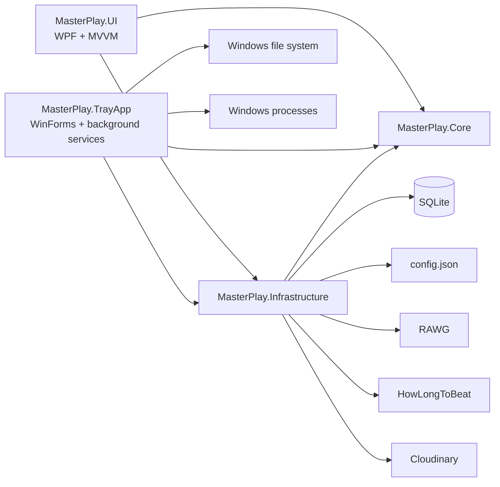
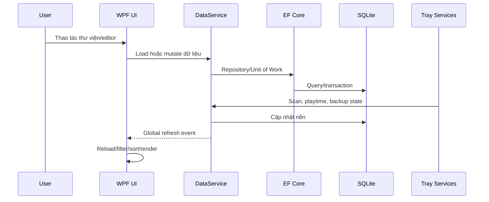

# MasterPlay Application Specification

## 1. Thông tin tài liệu

| Thuộc tính | Giá trị |
|---|---|
| Sản phẩm | MasterPlay |
| Loại ứng dụng | Ứng dụng Windows quản lý thư viện game cá nhân |
| Phạm vi khảo sát | Toàn bộ source trong `MasterPlaySystem.slnx` |
| Mốc source | Commit `fae3fad` |
| Nền tảng mục tiêu | Windows, .NET 8 |
| Thành phần chạy | MasterPlay.UI và MasterPlay.TrayApp |
| Ngôn ngữ giao diện | English, Tiếng Việt |

Tài liệu này mô tả trạng thái thực tế của source tại mốc trên. “Tính năng” là hành vi đã có luồng thực thi trong ứng dụng. Các thành phần mới chỉ tồn tại trong model, dependency hoặc source nhưng chưa được nối vào luồng sử dụng được ghi riêng tại phần giới hạn.

## 2. Mục tiêu sản phẩm

MasterPlay là công cụ quản lý thư viện game dành cho một người dùng trên máy Windows. Ứng dụng hợp nhất các nhu cầu:

- Lưu trữ metadata và ảnh của game.
- Tổ chức backlog, trạng thái chơi và play queue.
- Tìm kiếm, lọc, sắp xếp và phân trang thư viện.
- Khởi chạy game từ thư viện.
- Phát hiện game đã cài đặt và trạng thái game đang chạy.
- Ghi nhận thời gian chơi thực tế.
- Theo dõi thư mục save và tự động backup.
- Đồng bộ cover và gallery lên Cloudinary.
- Làm việc bằng English hoặc Tiếng Việt.

Ứng dụng không có tài khoản, phân quyền hoặc mô hình nhiều người dùng. Dữ liệu chính nằm cục bộ trên máy.

## 3. Công nghệ

### 3.1. Nền tảng và giao diện

| Thành phần | Công nghệ | Vai trò |
|---|---|---|
| Runtime | .NET 8 | Nền tảng chạy chung |
| Main UI | WPF, `net8.0-windows` | Giao diện quản lý thư viện |
| Tray App | Windows Forms, `net8.0-windows` | Tiến trình nền và menu system tray |
| Pattern UI | MVVM | Tách View, ViewModel và nghiệp vụ |
| MVVM toolkit | CommunityToolkit.Mvvm 8.4.0 | Observable state và command |
| Drag and drop | gong-wpf-dragdrop 4.0.0 | Sắp xếp Play Queue |
| Behaviors | Microsoft.Xaml.Behaviors.Wpf | Hành vi UI khai báo trong XAML |
| Emoji | Emoji.Wpf | Hiển thị ký hiệu/emoji trong WPF |
| DI | Microsoft.Extensions.DependencyInjection | Khởi tạo service và dependency |
| Configuration | Microsoft.Extensions.Configuration, JSON | Cấu hình ứng dụng |

### 3.2. Dữ liệu

| Thành phần | Công nghệ | Vai trò |
|---|---|---|
| Cơ sở dữ liệu | SQLite | Lưu thư viện và lịch sử |
| ORM | Entity Framework Core 8 | Mapping, truy vấn và cập nhật dữ liệu |
| Provider | Microsoft.Data.Sqlite | Kết nối SQLite |
| Repository | Generic Repository, repository chuyên biệt | Truy cập entity |
| Transaction boundary | Unit of Work | Gom repository và lưu thay đổi |
| JSON | Newtonsoft.Json, System.Text.Json | Đọc/ghi config và dữ liệu API |

SQLite được mở với connection pooling và default timeout 10 giây. Đường dẫn database lấy từ cấu hình người dùng.

### 3.3. Tích hợp

| Dịch vụ | Thư viện/cách kết nối | Chức năng |
|---|---|---|
| RAWG | HTTP/REST | Đồng bộ metadata, ngày phát hành, MetaScore và slug |
| HowLongToBeat | HowLongToBeat scraper | Tra cứu thời lượng chơi tham khảo |
| Cloudinary | CloudinaryDotNet | Upload cover/gallery và migrate ảnh |
| Windows Process API | `System.Diagnostics` | Phát hiện và khởi chạy process game |
| Windows Registry | HKCU Run | Start Tray App with Windows |
| FileSystemWatcher | .NET | Theo dõi thư viện game, save và config |

### 3.4. Logging

Tray App dùng Serilog:

- Mức log tối thiểu: Information.
- Log file theo ngày tại thư mục `logs` cạnh executable.
- Giữ tối đa 3 file log theo chính sách rolling hiện tại.
- Có lệnh mở thư mục log từ tray menu.

## 4. Kiến trúc hệ thống

### 4.1. Các project

#### MasterPlay.Core

Không phụ thuộc UI hoặc Infrastructure. Chứa:

- Entity và quan hệ dữ liệu.
- Model cấu hình.
- Danh sách ngôn ngữ.
- LocalizationService và toàn bộ chuỗi English/Tiếng Việt.

#### MasterPlay.Infrastructure

Phụ thuộc Core. Chứa:

- EF Core DbContext và mapping SQLite.
- Repository, Unit of Work và DataService.
- Đọc/ghi cấu hình JSON.
- File helper.
- Tích hợp RAWG, HowLongToBeat và Cloudinary.
- Event dùng để yêu cầu UI refresh.

#### MasterPlay.UI

Phụ thuộc Core và Infrastructure. Là WPF desktop app, tổ chức theo feature:

- Library.
- GameEditor.
- Queue.
- Settings.
- Scoring.
- Runtime services.
- Windowing services.
- Shared ViewModels.
- Styles và converters.

MainWindowViewModel điều phối thư viện. MainWindowActions tách việc mở window và khởi chạy game khỏi ViewModel. GameEditor dùng một GameEditorViewModel và GameEditorControl dùng lại trong GameEditorWindow.

#### MasterPlay.TrayApp

Phụ thuộc Core và Infrastructure. Là WinForms tray process, dùng DI để chạy ba singleton service:

- PlayTimeService.
- LibraryService.
- BackupService.

Tray App có vòng đời độc lập với Main UI. Hai app chia sẻ config và database.

### 4.2. Luồng dữ liệu chính

### 4.3. Cấu hình và lưu trữ

Config mặc định nằm tại:

`%AppData%\MasterPlay\config.json`

Giá trị mặc định:

- Database: `%AppData%\MasterPlay\MasterPlay.db`.
- Backup root: `%AppData%\MasterPlay\Backups`.
- Game library: `%UserProfile%\Documents\Games`.
- Language: `en-US`.

Các trường config:

- `BackupRootPath`.
- `GameLibraryPath`.
- `DatabasePath`.
- `Language`.
- `CloudinaryCloudName`.
- `CloudinaryApiKey`.
- `CloudinaryApiSecret`.
- `isDarkMode`.

## 5. Mô hình dữ liệu

### 5.1. Game

| Nhóm | Trường |
|---|---|
| Định danh | Id, Name, SlugName |
| Executable | ExeName, InitExeName, Ready, IsDisabled |
| File | SaveFolderPath, BackupFolderPath |
| Thời gian | TotalPlayTimeSeconds, PublishDate, FinishedIn, CreateAt |
| Hình ảnh | ImagePath, GImagePath |
| Nhà sản xuất | Publisher, Developer, SeriesId |
| Đánh giá | Score, MetaScore, Excited, AvgPlayTime |
| Phân loại | OwnershipId, ProgressId |
| Quan hệ | Series, Genres, Themes, GamePosition |

### 5.2. Danh mục

- `Series`: một game thuộc tối đa một series.
- `Genre`: quan hệ nhiều-nhiều với game qua `GameGenre`.
- `Theme`: quan hệ nhiều-nhiều với game qua `GameTheme`.
- Tên Series, Genre và Theme là duy nhất.

### 5.3. Trạng thái

- `ProgressStatus`: Id, Name, ColorCode, SortOrder.
- `OwnershipStatus`: Id, Name, ColorCode, SortOrder.
- UI nhận diện và dịch các giá trị trạng thái chuẩn sang ngôn ngữ hiện tại.

Các progress được dùng trong luồng hiện tại:

- Done.
- Playing.
- Next play.
- Intended.
- Dropped.
- Pending.

Các ownership được dùng trong bộ lọc hiện tại:

- Ready.
- Pirated.
- Game Pass.
- Not owned.
- PS required.

### 5.4. Queue, lịch sử và phát hiện executable

- `GamePosition`: quan hệ một-một với Game, lưu `PlayOrder`.
- `PlayDiary`: GameId, Date, TimeSpent, Notes; bị xóa cascade khi game bị xóa vật lý.
- `DetectedProcess`: ExeName và FullPath; FullPath là duy nhất.

## 6. Toàn bộ tính năng Main UI

### 6.1. Điều hướng thư viện

Main window cung cấp bốn chế độ:

1. All: mọi game chưa bị disable.
2. Planning: game chưa Done.
3. Finished: game Done.
4. Play Queue: game có trạng thái Playing, Next play hoặc Intended.

Chuyển chế độ sẽ áp dụng tập dữ liệu, cách hiển thị card và cách sort mặc định tương ứng.

### 6.2. Game card

Card hiển thị thông tin phù hợp với từng chế độ, gồm các trường liên quan như:

- Cover.
- Tên game.
- Series.
- Progress.
- Ownership.
- Score.
- MetaScore.
- Excited.
- Publish date.
- Avg playtime.
- Total playtime.
- Finished year.

Thao tác trên card:

- Mở Game Editor.
- Khởi chạy game.
- Hiển thị icon Playing khi executable tương ứng đang chạy.
- Tự trở lại trạng thái không chơi khi process game kết thúc.

GameProcessMonitor lấy snapshot process mỗi 2 giây, chỉ phát sự kiện khi danh sách process thay đổi để tránh refresh UI không cần thiết.

### 6.3. Khởi chạy game

- Tìm executable từ dữ liệu process đã được LibraryService phát hiện.
- Khởi chạy đường dẫn executable tương ứng qua Windows.
- Hiện cảnh báo theo ngôn ngữ hiện tại nếu không tìm thấy executable.

### 6.4. Search

Search hoạt động khi người dùng nhập và có debounce 280 ms. Phần lọc nặng chạy ngoài UI thread, sau đó chỉ cập nhật collection trên UI thread.

Phạm vi search:

- All.
- Name.
- Series.
- Publisher.
- Developer.
- Release year.

Search All đối chiếu:

- Tên game.
- Series.
- Genre.
- Theme.
- Chữ cái đầu của các từ trong tên, tách theo khoảng trắng, dấu gạch ngang, gạch dưới và dấu chấm.

Search bị tắt ở Play Queue để giữ trải nghiệm sắp xếp queue nhất quán.

### 6.5. Filter

Filter mở bằng popup có nền trang trước bị phủ đen mờ. Esc đóng popup.

Các nhóm lọc:

| Nhóm | Điều kiện |
|---|---|
| Finished year | `>`, `>=`, `=`, `<=`, `<` |
| Excited | `>`, `>=`, `=`, `<=`, `<` |
| Score | `>`, `>=`, `=`, `<=`, `<` |
| Total playtime | `>`, `>=`, `=`, `<=`, `<` |
| Avg length | Very long, Long, Medium, Short, Very short, None |
| Progress | Next play, Done, Playing, Intended, Dropped, Pending |
| Ownership | Ready, Pirated, Game Pass, Not owned, PS required |
| MetaScore | Very high, High, Medium, Low, Very low, None |

Ngưỡng Avg length:

- Very long: từ 80 giờ.
- Long: 60–79 giờ.
- Medium: 35–59 giờ.
- Short: 20–34 giờ.
- Very short: 1–19 giờ.
- None: chưa có dữ liệu.

Ngưỡng MetaScore:

- Very high: từ 90.
- High: 80–89.
- Medium: 70–79.
- Low: 50–69.
- Very low: 1–49.
- None: chưa có dữ liệu.

Thao tác:

- Apply.
- Clear.
- Cancel.
- Reverse filter để đảo kết quả khớp/không khớp.

### 6.6. Sort

Các kiểu sort:

- Default.
- Status.
- Name.
- PlayTime.
- Publish.
- MetaScore.
- Excited.
- Score.
- Ownership.
- Progress.
- AvgPlaytime.

Có tùy chọn đảo chiều sort.

Sort mặc định theo chế độ:

- All: Ready giảm dần, PublishDate giảm dần, Excited giảm dần, Name, Progress, Ownership.
- Planning: Progress, Excited giảm dần, AvgPlayTime tăng dần, Name.
- Finished: Progress, Score giảm dần, Finished year giảm dần, PublishDate giảm dần, MetaScore giảm dần.
- Play Queue: PlayOrder, Excited giảm dần, AvgPlayTime tăng dần.

### 6.7. Phân trang

- 30 game mỗi trang ở các chế độ thư viện.
- Previous/Next.
- Hiển thị tóm tắt trang hiện tại.
- Play Queue lấy toàn bộ item để phục vụ drag-and-drop.

### 6.8. Play Queue

Play Queue hiển thị dạng danh sách/bảng:

- Image.
- Name.
- Progress.
- Excited.
- Published.
- MetaScore.
- AvgPlay.
- Ownership.

Tính năng:

- Kéo thả để đổi thứ tự.
- Lưu thứ tự vào `GamePosition`.
- Double-click để mở editor.
- Nút mở editor.
- Promote một game lên Next Play và tự tái sắp xếp queue.
- Điều chỉnh vị trí khi progress của game thay đổi.

### 6.9. Phím tắt

| Phím | Hành động |
|---|---|
| F5 | Reload dữ liệu |
| F6 | Reset search, view, sort, reverse và reload |
| F11 | Chuyển maximize/normal |
| ` | Mở Add Game |
| Ctrl+1 | All |
| Ctrl+2 | Planning |
| Ctrl+3 | Finished |
| Ctrl+4 | Play Queue |
| Esc | Đóng ComboBox, popup hoặc modal đang ưu tiên |

### 6.10. Modal và popup

- Khi modal/popup mở, nội dung phía sau có lớp phủ đen mờ.
- Esc đóng lớp tương tác trên cùng trước.
- Modal child window dùng owner là MainWindow.
- Các ComboBox đang mở được đóng trước khi đóng window.

## 7. Toàn bộ tính năng Game Editor

### 7.1. Chế độ

- Add Game.
- Xem chi tiết ở trạng thái read-only.
- Chuyển sang Edit.
- Save.
- Cancel.
- Close.

### 7.2. Trường có thể quản lý

- Game name.
- Score.
- Total playtime.
- Publish date.
- Publisher.
- Developer.
- Series.
- Nhiều Genres.
- Nhiều Themes.
- MetaScore.
- AvgPlaytime.
- Excited.
- Ownership.
- Progress.
- FinishedIn.
- ExeName.
- InitExeName.
- SaveFolderPath.
- BackupFolderPath.
- Cover path/URL.
- Gallery path/URL.
- SlugName được quản lý nội bộ.

### 7.3. Metadata

- Đồng bộ metadata từ RAWG.
- Chuẩn hóa tên.
- Lấy publisher.
- Lấy developer.
- Lấy slug.
- Lấy Metacritic score.
- Lấy thời lượng trung bình.
- Lấy ngày phát hành.
- Đồng bộ cover riêng.
- Đồng bộ gallery riêng.
- Refresh preview ảnh từ local path hoặc URL.

### 7.4. Ảnh

- Chấp nhận nguồn ảnh local hoặc URL.
- Khi lưu, ảnh chưa nằm trên Cloudinary được thử upload.
- Cover lưu trong `MasterPlay/Covers/{GameId}`.
- Gallery lưu trong `MasterPlay/Galleries/{GameId}`.
- Upload dùng overwrite và invalidate.
- Lỗi upload không chặn việc lưu game.
- Có khả năng xóa ảnh Cloudinary theo GameId ở tầng service.

### 7.5. Series, Genre và Theme

- Chọn một Series.
- Chọn nhiều Genres.
- Chọn nhiều Themes.
- Tìm trong danh sách.
- Tạo mới trực tiếp từ nội dung search.
- Sửa Series.
- Sửa Genre.
- Sửa Theme.
- Xóa sau khi xác nhận.
- Khi xóa danh mục, association với game được xử lý lại.
- Popup quản lý có lớp phủ và hỗ trợ Esc.

### 7.6. Folder và backup metadata

- Chọn Save folder.
- Chọn Backup folder.
- Mở Save folder bằng Explorer.
- Mở Backup folder bằng Explorer.
- Tự tạo backup folder từ backup root và tên game đã làm sạch.
- Tránh trùng tên folder.
- Tạo `SaveLocation.txt` trong backup folder.
- Cập nhật nội dung `SaveLocation.txt` khi SaveFolderPath thay đổi.
- Đổi tên backup folder khi tên game thay đổi.
- Khi thêm game mới, tự tạo backup folder nếu có thể.

### 7.7. Playtime và tra cứu ngoài

- Tăng playtime bằng số phút dương do người dùng nhập.
- Giảm playtime bằng số phút dương do người dùng nhập.
- Mở trang HowLongToBeat theo tên game để kiểm tra playtime.
- Mở trang Metacritic theo slug để kiểm tra MetaScore.
- Infrastructure có hàm scraper HowLongToBeat trả về Main + Extras.

### 7.8. Progress và điểm

- Thay đổi progress.
- Khi progress đổi, cập nhật vị trí queue tương ứng.
- Promote to Next Play.
- Finish Game bằng popup:
  - Nhập score.
  - Chấp nhận 0–100.
  - Chấp nhận giá trị đặc biệt 999, hiển thị dạng `10🔥`.
  - Chuyển progress sang Done.
  - Ghi năm hoàn thành hiện tại.
  - Lưu game.

### 7.9. Disable game

- Xác nhận trước khi thực hiện.
- Soft delete bằng `IsDisabled`.
- Game bị disable không còn xuất hiện trong thư viện chính.

## 8. Toàn bộ tính năng Settings

- Chọn ngôn ngữ.
- English được hiển thị bằng tên bản địa `English`.
- Tiếng Việt được hiển thị bằng tên bản địa `Tiếng Việt`.
- Preview ngôn ngữ ngay khi chọn.
- Save để ghi ngôn ngữ vào config.
- Cancel/Close để khôi phục ngôn ngữ trước khi mở Settings.
- Chọn Backup root folder.
- Chọn đường dẫn config JSON.
- Chọn đường dẫn database `.db`.
- Thêm nhiều game library path.
- Sửa game library path.
- Xóa game library path.
- Lưu config ra JSON.
- Hiển thị trạng thái lưu theo ngôn ngữ hiện tại.
- Esc đóng ComboBox trước, sau đó đóng Settings.
- Hiển thị lớp phủ đen mờ trên owner khi Settings mở.

## 9. Localization

### 9.1. Ngôn ngữ

- `en-US`: English.
- `vi-VN`: Tiếng Việt.

### 9.2. Hành vi

- Chuỗi giao diện được lưu trong LocalizationService.
- Thay đổi `CurrentCulture` và `CurrentUICulture`.
- Phát `LanguageChanged`.
- WPF cập nhật DynamicResource đang dùng.
- Main UI, popup, cảnh báo và Settings đổi ngôn ngữ trực tiếp.
- Tên kỹ thuật cần thiết được giữ nguyên hoặc viết gọn.
- Progress và Ownership lấy từ database được normalize trước khi dịch.
- Tray App theo dõi config và tự tải lại ngôn ngữ sau debounce 500 ms.
- Menu tray và thông báo tray dùng ngôn ngữ hiện tại.

## 10. Toàn bộ tính năng Tray App

### 10.1. Vòng đời

- Chạy dưới dạng NotifyIcon trong system tray.
- Ba service nền tự khởi động.
- Trạng thái check của từng service hiển thị trên menu.
- Có thể bật/tắt riêng từng service.
- Exit dừng service và giải phóng tài nguyên.

### 10.2. Tray menu

- Playtime Tracking.
- Library Scanner.
- Backup Service.
- Sync Images to Cloudinary.
- Open Log Folder.
- Start with Windows.
- Exit.

Lệnh sync ảnh có khóa chống chạy đồng thời, ghi tiến độ và hiện balloon summary khi hoàn tất.

### 10.3. Start with Windows

- Đọc trạng thái hiện tại từ `HKCU\SOFTWARE\Microsoft\Windows\CurrentVersion\Run`.
- Bật bằng cách ghi đường dẫn Tray App.
- Tắt bằng cách xóa registry value.
- Dấu check của menu đồng bộ lại với trạng thái registry thực tế.
- Không cần quyền administrator vì dùng HKCU.

## 11. Ba background service

### 11.1. PlayTimeService

Mục đích: chỉ tính thời gian người dùng thực sự chơi.

Điều kiện cộng thời gian:

- Executable của game đang chạy.
- Process game đang ở foreground.
- Người dùng không idle quá 30 giây.

Chu kỳ:

- Sample process: 5 giây.
- Refresh danh sách game: 1 phút.
- Flush dữ liệu xuống database: 30 giây và khi service dừng.

Hành vi:

- Cộng dồn số giây theo từng game trong bộ nhớ.
- Batch ghi `TotalPlayTimeSeconds`.
- Tạo record `PlayDiary`.
- Nếu ghi lỗi, dữ liệu được đưa lại hàng đợi để retry.
- Phát hiện chuyển trạng thái từ running sang stopped.
- Thông báo cho BackupService khi game dừng.

### 11.2. LibraryService

Mục đích: phát hiện executable và đồng bộ khả năng sẵn sàng của game.

Hành vi:

- Scan đệ quy mọi game library path hợp lệ.
- Tìm file `.exe`.
- Bỏ qua file/folder Hidden, System và vị trí không truy cập được.
- Loại trùng đường dẫn không phân biệt hoa thường.
- Initial scan khi khởi động.
- Full scan mỗi 15 phút.
- Theo dõi Created, Deleted, Renamed bằng FileSystemWatcher.
- Debounce thay đổi 2 giây.
- Chỉ ghi lại khi tập đường dẫn executable thực sự thay đổi.
- Đồng bộ bảng `DetectedProcess`.
- Đồng bộ `Game.Ready`.
- Đảm bảo active game có backup folder sau lần đồng bộ có thay đổi.
- Dùng semaphore để không chạy hai lần scan cùng lúc.

### 11.3. BackupService

Mục đích: tạo snapshot thư mục save theo thay đổi và khi game kết thúc.

Hành vi:

- Theo dõi SaveFolderPath của mọi active game.
- Theo dõi đệ quy Changed, Created, Deleted, Renamed.
- Debounce file event 15 giây.
- Refresh danh sách watcher mỗi 5 phút.
- Nhận sự kiện backup khi game dừng.
- Giới hạn tối thiểu 2 phút giữa hai backup của cùng game.
- Dùng queue và lock để serialize quá trình backup.
- Tạo backup folder nếu chưa tồn tại.
- Copy toàn bộ cây thư mục save.
- Snapshot có tên `Backup_yyyyMMdd_HHmmss`.
- File đích trùng được overwrite trong snapshot đang tạo.

## 12. Data access và nghiệp vụ Infrastructure

DataService cung cấp các nhóm thao tác:

- Load toàn bộ game.
- Load active game.
- Load game kèm đầy đủ quan hệ.
- Add game.
- Update game.
- Ghi playtime.
- Load và lưu queue position.
- Đồng bộ detected process.
- Đồng bộ trạng thái Ready.
- Load ProgressStatus.
- Load OwnershipStatus.
- Load, add, update, delete Series.
- Load, add, update, delete Genre.
- Load, add, update, delete Theme.
- Tạo backup folder duy nhất.
- Đổi tên backup folder.
- Cập nhật `SaveLocation.txt`.
- Xử lý progress change.
- Reorder khi Promote to Next Play.
- Kiểm tra/làm sạch tên folder.

GameRepository eager-load các quan hệ cần thiết cho màn thư viện/editor để tránh truy vấn rời rạc khi render.

## 13. Yêu cầu vận hành và hiệu năng đang được áp dụng

- Search debounce 280 ms.
- Search/filter nặng không chạy trên UI thread.
- Process monitor chỉ báo khi snapshot thay đổi.
- Process monitor chu kỳ 2 giây, không busy-loop.
- Playtime ghi batch mỗi 30 giây thay vì ghi mỗi sample.
- Library watcher debounce 2 giây và full scan 15 phút.
- Backup watcher debounce 15 giây và có khoảng cách backup tối thiểu.
- Config watcher debounce 500 ms.
- Semaphore/lock ngăn scan, sync ảnh và backup chồng lấn.
- SQLite connection pooling.
- UI phân trang 30 item.
- Các service có CancellationToken và dừng có kiểm soát.
- Các thao tác file/API dài được thực hiện bất đồng bộ ở những luồng chính.

## 14. Thông báo và xử lý lỗi

- Cảnh báo không tìm thấy executable.
- Xác nhận disable game.
- Xác nhận xóa Series/Genre/Theme.
- Validate score và số phút nhập.
- Validate folder/path ở các thao tác liên quan.
- Lỗi upload Cloudinary không chặn lưu metadata game.
- Service nền log exception thay vì làm tray process dừng.
- Playtime requeue khi ghi database lỗi.
- Library scan bỏ qua vị trí không truy cập được.
- Các thông báo hướng người dùng được chọn theo ngôn ngữ hiện tại.

## 15. Phạm vi chưa phải tính năng hoàn chỉnh

Các mục sau tồn tại trong source hoặc dependency nhưng chưa tạo thành tính năng người dùng hoàn chỉnh:

- `Config.isDarkMode` tồn tại nhưng chưa có luồng Settings/theme hoàn chỉnh.
- `Steamworks.NET` là dependency của Infrastructure nhưng chưa có luồng Steam được nối vào UI hoặc service chính.
- `InputScoreWindow` riêng tồn tại với thang 0–10/999, trong khi Finish Game đang dùng popup thang 0–100/999; không có call site hoạt động rõ ràng cho window phụ.
- Cloudinary có hàm xóa ảnh nhưng soft-disable game không tương đương xóa ảnh remote.
- HowLongToBeat scraper có ở Infrastructure; UI hiện chủ yếu mở trang tra cứu ngoài.
- Không có màn hình restore game đã disable.
- Không có restore backup tự động; ứng dụng tạo snapshot, người dùng tự xử lý restore.
- Không có tài khoản, đồng bộ database đa máy, cloud save, achievements, social, store purchasing hoặc parental control.
- Không có hệ thống plugin/mod.
- Không có updater tự động.

## 16. Ràng buộc và điểm cần lưu ý

- Chỉ hỗ trợ Windows.
- Main UI và Tray App phải trỏ tới cùng config/database để thấy cùng dữ liệu.
- Tray App cần chạy để có library scan định kỳ, playtime tracking và automatic backup.
- Playtime chỉ tăng khi game foreground và người dùng không idle.
- Backup phụ thuộc SaveFolderPath hợp lệ.
- Ready/launch phụ thuộc ExeName khớp executable đã scan.
- Cloudinary cần đủ cloud name, API key và API secret trong config.
- RAWG cần credential hợp lệ. Credential không nên hard-code trong source; nên chuyển hoàn toàn sang config an toàn hoặc user secrets.
- Config hiện chứa secret dạng file JSON cục bộ, vì vậy cần kiểm soát quyền truy cập và không commit file config thật.

## 17. Tiêu chí chấp nhận tổng thể

Một bản build được xem là đáp ứng chức năng hiện tại khi:

1. Solution build thành công trên Windows với .NET 8.
2. Main UI mở được và đọc đúng database/config.
3. All, Planning, Finished và Play Queue hoạt động.
4. Search, filter, sort, reverse và pagination cho kết quả đúng.
5. Add/Edit/Disable game và quản lý danh mục lưu được.
6. Game launch hoạt động khi executable được phát hiện.
7. Playing icon tự bật/tắt theo process.
8. Queue drag-and-drop được lưu.
9. Settings lưu path và ngôn ngữ; UI/notification đổi ngôn ngữ.
10. Tray App khởi động và ba service có thể bật/tắt.
11. Start with Windows phản ánh đúng trạng thái registry.
12. Library scan cập nhật DetectedProcess và Ready.
13. Playtime chỉ ghi khi thỏa điều kiện foreground/idle.
14. Save change hoặc game stop tạo backup theo policy.
15. Cloudinary sync chạy và báo kết quả mà không khóa menu chạy lặp.
16. Esc và lớp phủ hoạt động trên các modal/popup.

